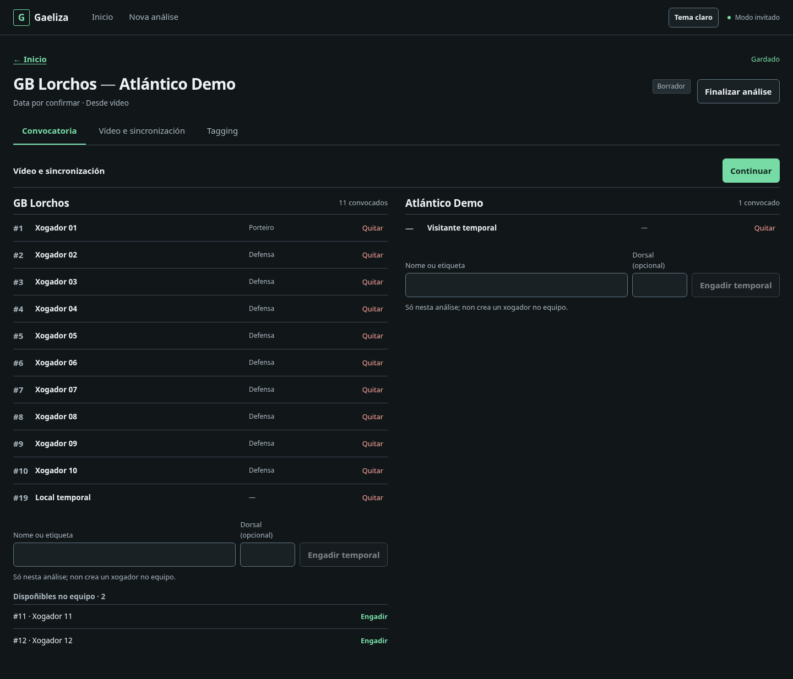
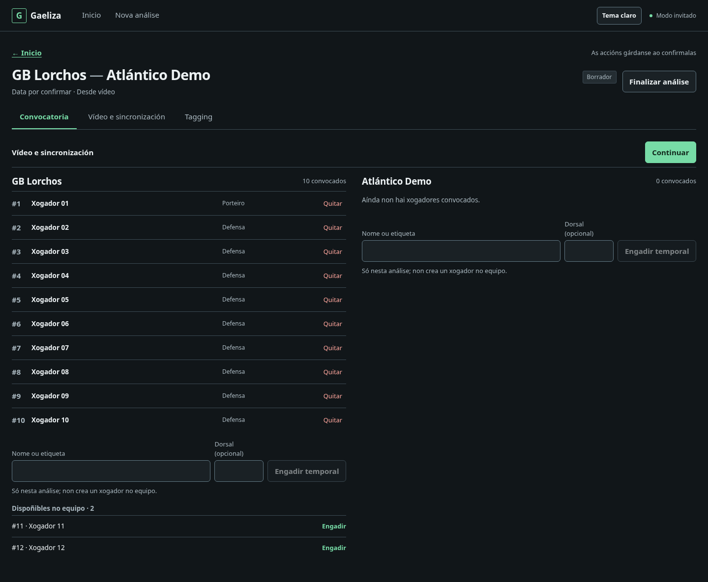
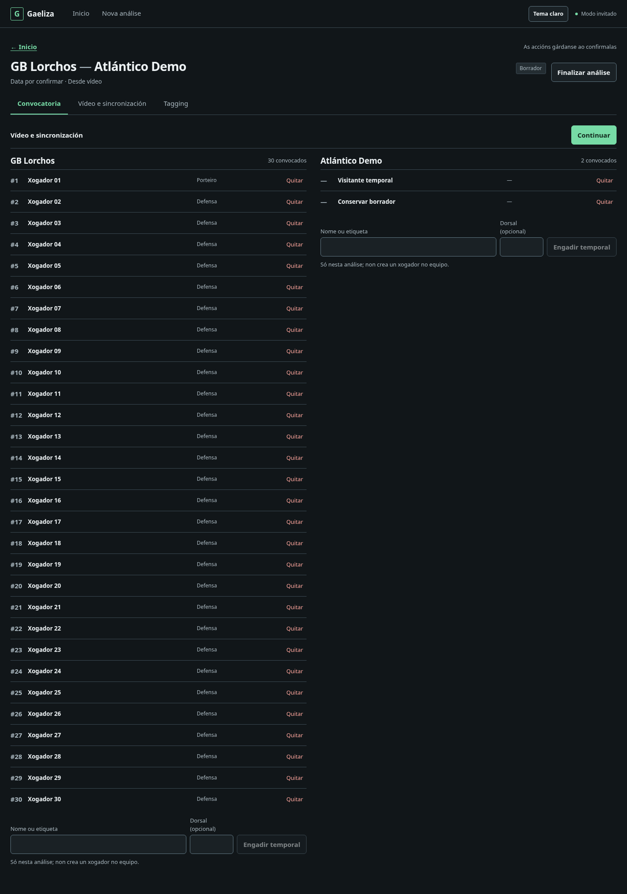
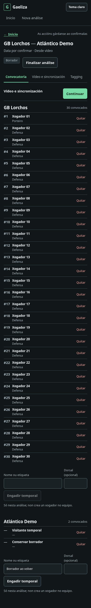

# Convocatoria — capturas de revisión

Fixtures sintéticos locales. Documentación del PR, no assets del producto.

- [Desktop con ambos equipos](desktop-both-teams.png)
- [Desktop con rival vacío](desktop-empty-rival.png)
- [Convocatoria de 30 jugadores](desktop-long-roster.png)
- [Móvil](mobile.png)






Desde `gaeliza-frontend`, con Playwright/Chromium externos:

```sh
ROSTER_SCREENSHOT_DIR=../docs/screenshots/v2-roster-ergonomics node --test tests/roster-browser.mjs
```
