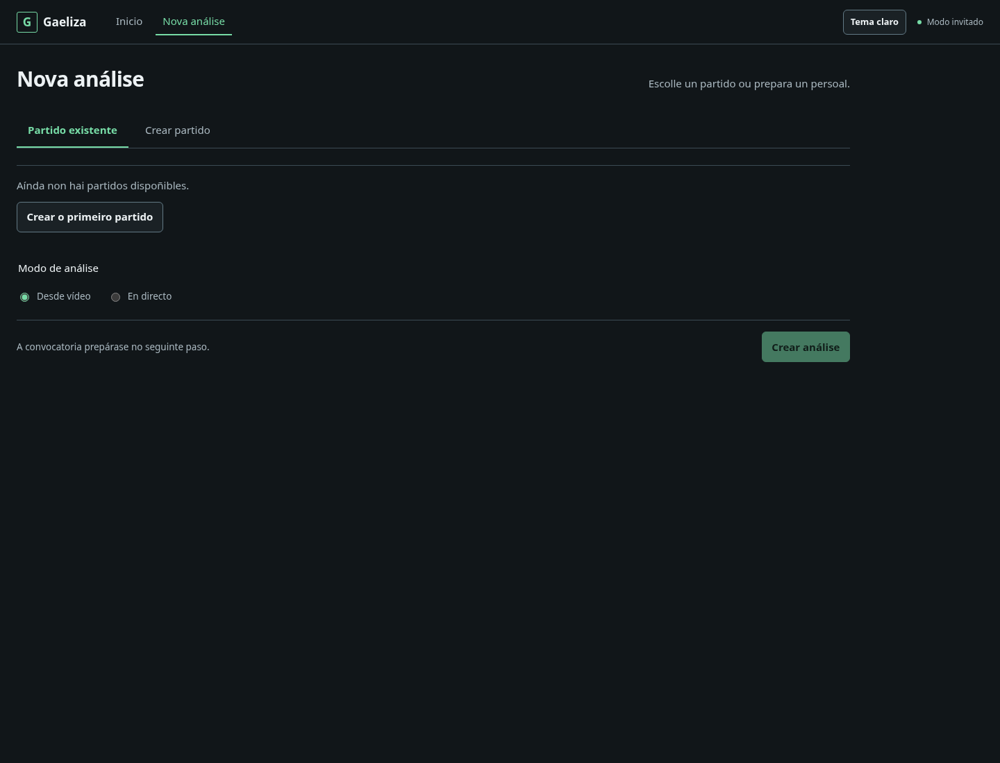
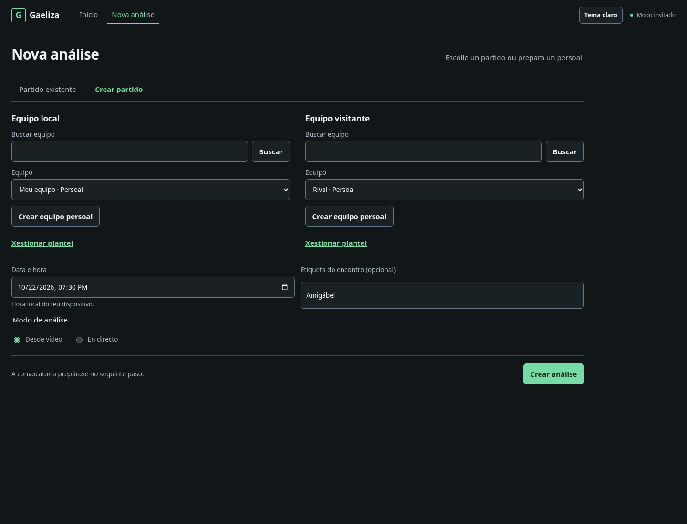
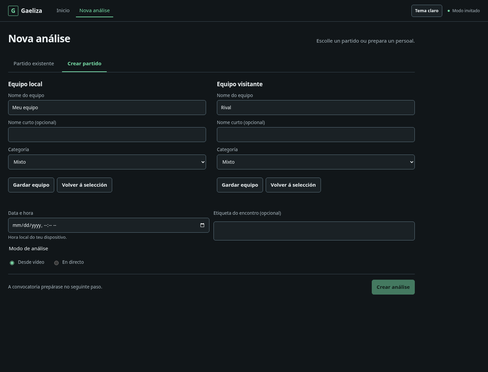
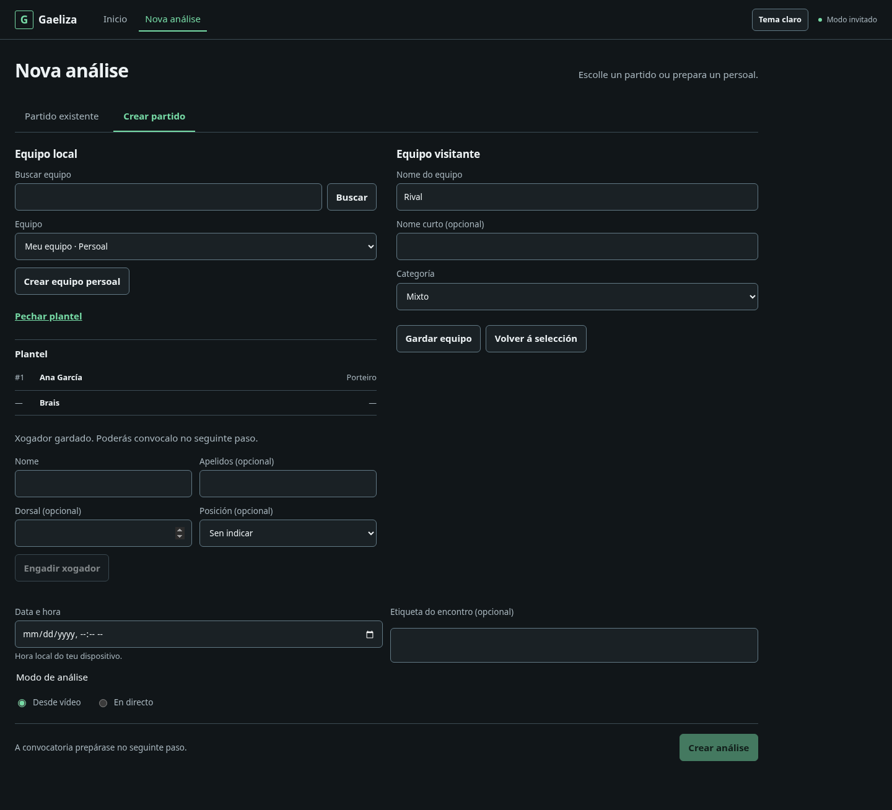
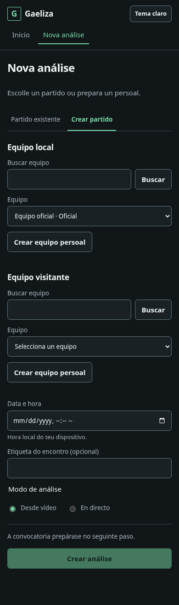

# Nova análise: preparación autosuficiente

Capturas locales con fixtures sintéticos, sin conexión a Supabase remoto. Abrir cada imagen para verla a tamaño completo.

## Cuenta vacía



## Crear partido en escritorio



## Crear equipos inline



## Plantel persistente



## Móvil



Regenerar desde `gaeliza-frontend` con Playwright disponible:

```sh
SETUP_SCREENSHOT_DIR=../docs/screenshots/v2-self-service-match-setup node --test tests/self-service-browser.mjs
```

El harness acepta `PLAYWRIGHT_CHROMIUM_EXECUTABLE_PATH` para un Chromium instalado localmente.
