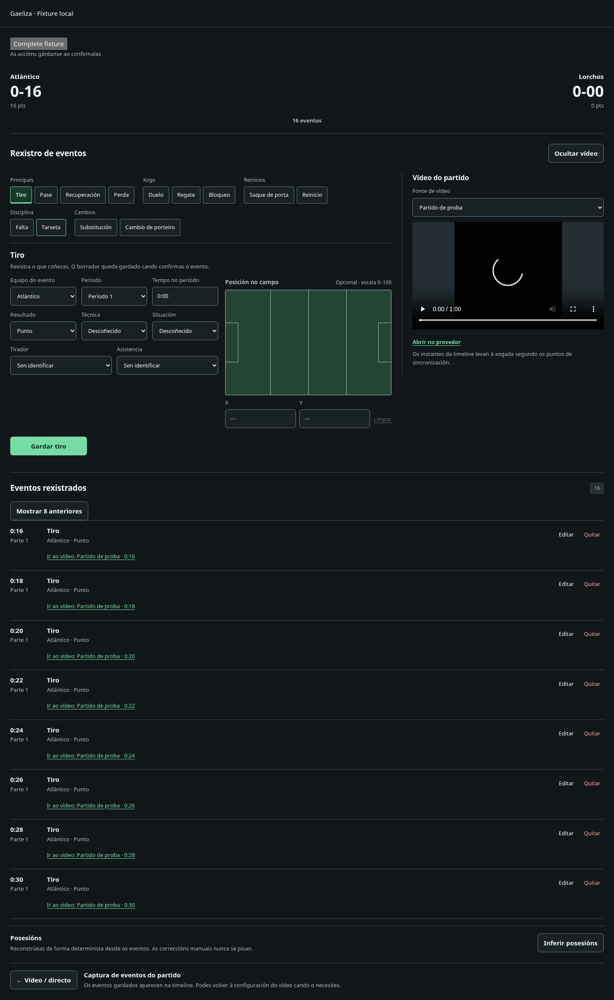
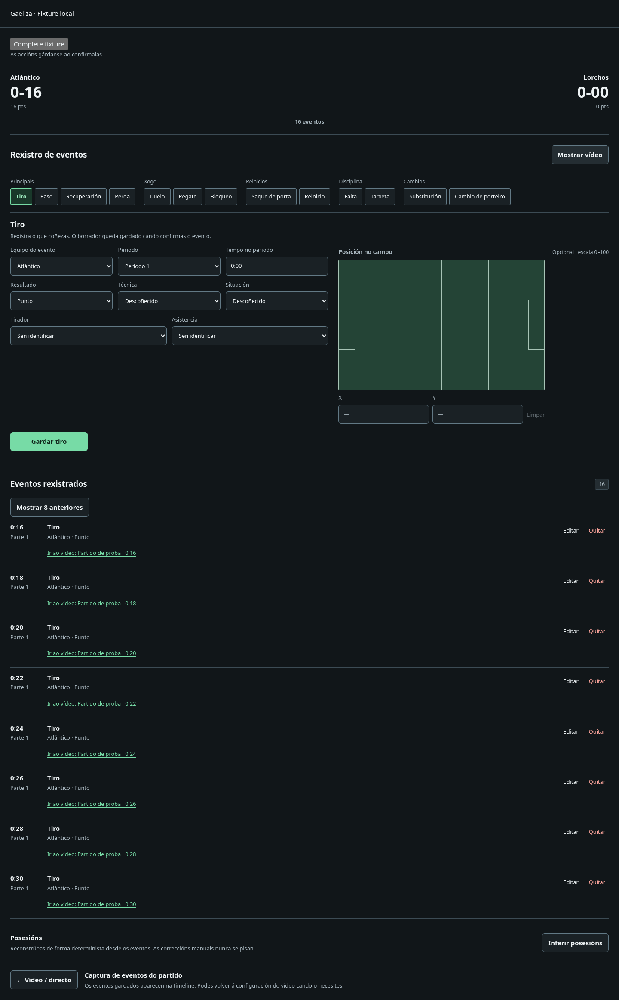
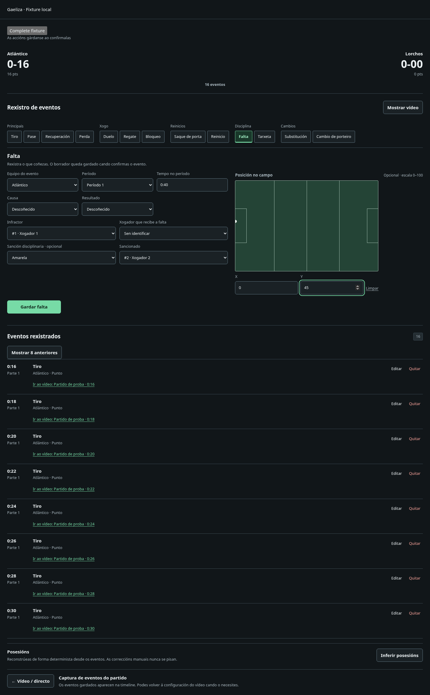
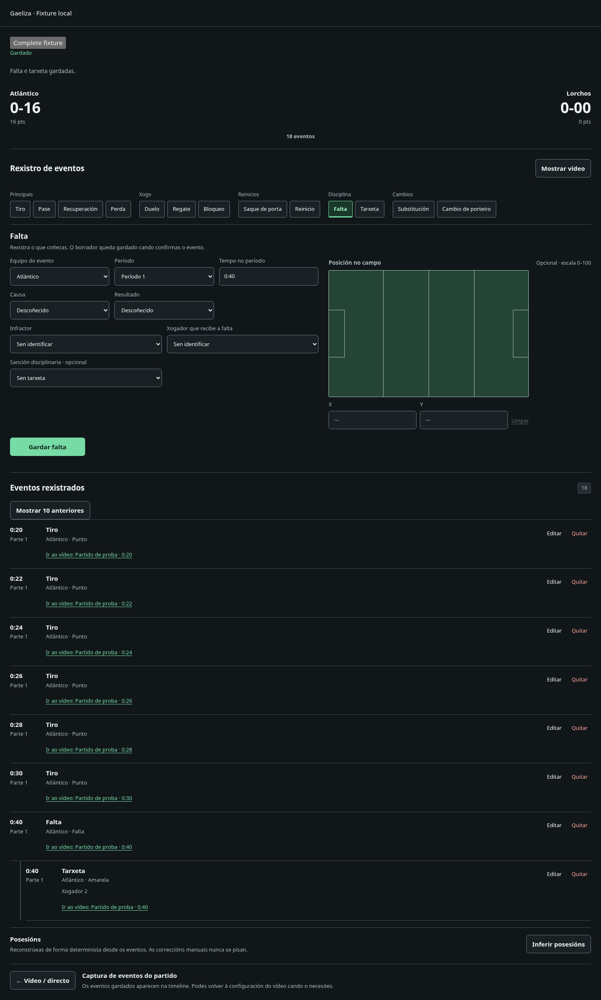
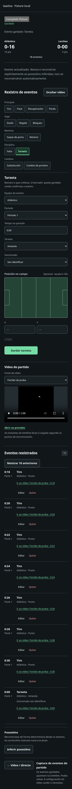

# Capturas de ergonomía de tagging

Fixtures locales de revisión, sin datos reales. Son documentación del PR, no assets
del producto. Abrir cada imagen para verla a resolución completa.

- [Desktop con vídeo](desktop-video.png)
- [Desktop sin vídeo](desktop-no-video.png)
- [Falta con tarjeta opcional](foul-with-card.png)
- [Timeline con falta y tarjeta relacionada](linked-timeline.png)
- [Tagging móvil](mobile.png)







Regeneración desde `gaeliza-frontend`, con Playwright y Chromium externos disponibles:

```sh
ERGONOMICS_SCREENSHOT_DIR=../docs/screenshots/v2-tagging-ergonomics node --test tests/ergonomics-browser.mjs
```
