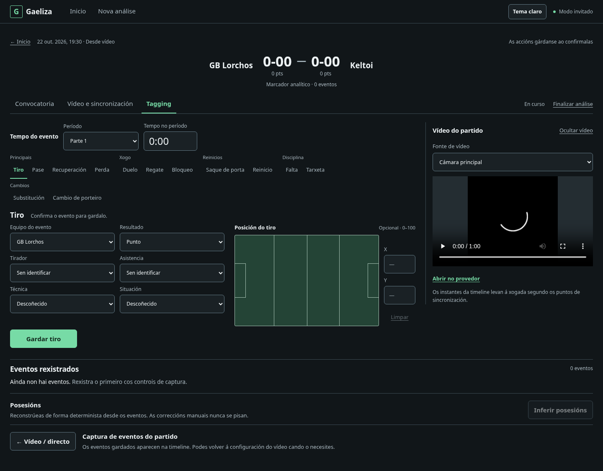
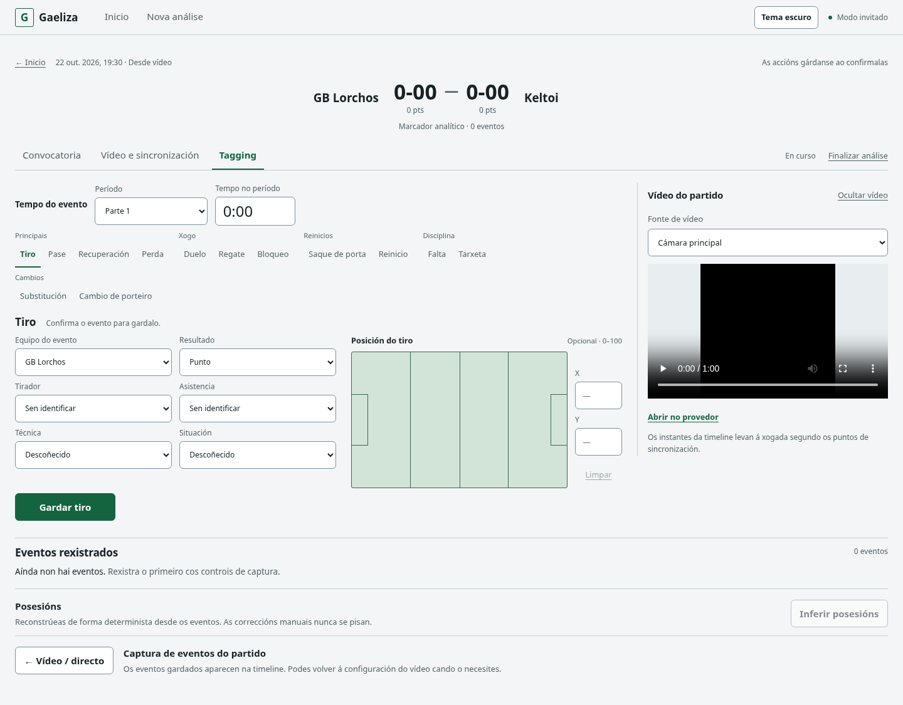
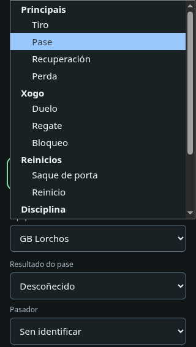

# Tagging workstation — revisión visual PR B

Capturas **sintéticas locales**, con páginas, componentes y capa data reales sobre transporte PostgREST/RPC simulado. No se accedió a Supabase remoto. El vídeo negro es una fixture WebM local. Se conservan todas las capturas anteriores del repositorio.

Este slice mantiene el shell aprobado en PR #11 y cambia la estación de captura/revisión: tiempo manual del evento, acciones agrupadas, resultado/protagonistas/enriquecimiento, posición funcional, vídeo auxiliar y secuencia reciente. No modifica modelos, consultas, RPC, RLS, coordenadas, sincronización, score, lifecycle ni inferencia de posesiones.

## Galería completa

Los PNG son full-page salvo la captura del selector nativo abierto. Los tamaños indican el viewport, no la altura del archivo resultante.

| Viewport | Estado | Captura |
| --- | --- | --- |
| 1440×900 | Tiro + vídeo, dark | [shot-video-dark](shot-video-dark.png) |
| 1440×900 | Tiro sin vídeo, dark | [shot-no-video-dark](shot-no-video-dark.png) |
| 1440×900 | Tiro + vídeo, light | [shot-video-light](shot-video-light.png) |
| 1440×900 | Falta con sanción opcional y destinatario distinto | [foul-optional-card](foul-optional-card.png) |
| 1440×900 | Falta/tarjeta relacionadas, eventos independientes | [linked-discipline-timeline](linked-discipline-timeline.png) |
| 1440×900 | Completed, lectura y vídeo | [completed-dark](completed-dark.png) |
| 1440×900 | Varias fuentes por evento | [multiple-video-sources](multiple-video-sources.png) |
| 1440×900 | Evento en edición y marca textual en timeline | [editing-event](editing-event.png) |
| 1366×768 | Tiro + vídeo | [shot-video-1366](shot-video-1366.png) |
| 1366×768 | Pase sin vídeo, origen/destino juntos | [pass-no-video-1366](pass-no-video-1366.png) |
| 1366×768 | Nombres largos de equipos/jugadores | [long-names-1366](long-names-1366.png) |
| 1024×900 | Tablet; vídeo después de captura | [tablet-1024](tablet-1024.png) |
| 768×1024 | Tablet; campo apilado para no estrechar datos | [tablet-768](tablet-768.png) |
| 390×844 | Tiro | [shot-mobile-390](shot-mobile-390.png) |
| 390×844 | Falta, vídeo oculto | [foul-mobile-390](foul-mobile-390.png) |
| 390×844 | Vídeo abierto después de Guardar | [video-open-mobile-390](video-open-mobile-390.png) |
| 390×844 | Timeline expandida | [timeline-expanded-mobile-390](timeline-expanded-mobile-390.png) |
| 320×568 | Tiro | [shot-mobile-320](shot-mobile-320.png) |
| 320×568 | Selector compacto usable con teclado | [action-selector-mobile-320](action-selector-mobile-320.png) |
| 320×568 | Selector nativo abierto, con grupos y scroll del sistema | [action-selector-open-320](action-selector-open-320.png) |
| 320×568 | Nombres largos | [long-names-mobile-320](long-names-mobile-320.png) |
| 1440×900 | Error de guardado, borrador conservado | [save-error](save-error.png) |
| 1440×900 | Error de lectura, score desconocido y recarga | [load-error](load-error.png) |
| 1440×900 | Fuente de vídeo no disponible | [video-unavailable](video-unavailable.png) |







## Composición y decisiones consolidadas

- **Acciones:** trece botones simultáneos en desktop, con grupos existentes, selección por peso/subrayado y `aria-pressed`; foco independiente. Bajo 768 px, select nativo con label explícito Acción, los trece tipos y cinco optgroups. El mismo callback conserva los resets existentes.
- **Tiempo:** región «Tempo do evento» antes de acción/formulario. Período y tiempo siguen siendo manuales, sin timers ni lectura automática del vídeo. Las columnas se adaptan al tamaño del texto; se prueba `18:42` al 200% sin recortar el valor.
- **Datos:** equipo/resultado primero, protagonistas después, técnica/situación/otros detalles secundarios accesibles. Los trece tipos conservan controles, defaults, payloads y validaciones. Guardar sigue siendo explícito y próximo a los datos.
- **Posición:** título específico de la jugada; X/Y y Limpar secundarios junto al campo en desktop y debajo en tablet estrecha/móvil. Sin vídeo, el pase puede presentar origen y destino juntos dentro de la captura. En tarjeta/cambios, las posiciones opcionales existentes se conservan en un disclosure sin reservar una columna; al editar coordenadas ya guardadas se abre inicialmente.
- **Vídeo:** columna auxiliar 400/360 px en escritorio; bajo 1200 pasa al flujo después de Guardar. Mostrar/Ocultar devuelve ancho y desmonta el player; se verificó que el elemento HTML5 retirado queda pausado. Los botones intercambian foco accesiblemente. No hay sticky de controles/player, overlays, storage nueva, SDK ni autoplay.
- **Timeline:** gutter temporal, separador de período, acción/equipo/protagonista/resultado en una línea cuando caben, enlaces y operaciones secundarios. Se omite repetir como resultado el mismo nombre del tipo sin información añadida. Ocho recientes iniciales, expansión explícita, mismo orden y mismas fuentes. Las filas no tienen altura fija.
- **Disciplina:** sangría más texto «Vinculada á falta…», dos eventos y acciones independientes. Borrar la falta conserva la tarjeta y elimina el vínculo visual. La tarjeta aislada continúa disponible.
- **Edición:** marca lateral más «En edición»; foco al título del editor y retorno al botón Editar al guardar/cancelar. Completed mantiene secuencia completa y vídeo, sin formulario editable.
- **Errores:** mensajes reales y borrador conservado. Fallo de lectura inicial no se presenta como una timeline vacía confirmada; hay estado pendiente de recarga. No se ocultan avisos para cumplir una altura.


## Medidas observadas

Sin alturas fijas, píxeles CSS y texto normal salvo filas de zoom. [Datos completos](measurements.json). La medida hasta Guardar usa el borde inferior de navegación como origen.

| Estado | Captura | Vídeo | Campo | Nav → fin de Guardar | Inicio timeline (Y) |
| --- | ---: | ---: | ---: | ---: | ---: |
| shot-video-1440 | 968 | 400 | 345 | 559,8 | 858,5 |
| shot-no-video-1440 | 1392 | Oculto | 473 | 573,9 | 872,6 |
| shot-video-1366 | 934 | 360 | 345 | 559,8 | 858,5 |
| pass-no-video-1366 | 1318 | Oculto | 449 | 684,7 | 983,4 |
| tablet-1024 | 976 | 720 | 345 | 559,8 | 1500,8 |
| tablet-768 | 736 | 720 | 480 | 957,2 | 2009,9 |
| shot-mobile-390 | 358 | 358 | 358 | 1122,5 | 2054,6 |
| long-names-mobile-320 | 288 | 288 | 288 | 1078,2 | 2074,9 |

En 1440×900, el Tiro normal conserva los trece controles desktop visibles, Guardar dentro del viewport y el comienzo de la timeline. A 1366×768 y en formularios complejos se acepta scroll de documento. Overflow horizontal = 0 en toda la matriz, incluidos 200% de texto y nombres largos. Estas medidas no incluyen un error/aviso que aumente la altura; los mensajes tienen prioridad.

## Regresiones verificadas

El harness nuevo recorre y guarda los trece tipos en escritorio y móvil; comprueba pares de coordenadas, vacío, 0/0, 100/100, click, touch y Limpar. Verifica destino de kickout 0/0, origen null/null y edición de kickout antiguo con origen previo. También conserva posiciones opcionales de cambios al cerrar el disclosure.

Falta sin tarjeta, falta+sanción en una sola llamada al RPC existente, sugerencia desde infractor y destinatario diferente, tarjeta aislada, edición/cancelación, borrado de falta con tarjeta restante. Es una regresión UI/contrato: no sustituye las pruebas PostgreSQL previas de atomicidad y no reimplementa la transacción en React.

Timeline de 0, 1, 8 y más de 8 eventos; expandir anteriores, cuatro fuentes, edición activa, borrado y completed. HTML5, seek derivado, YouTube seguro, fallback externo y error de media siguen cubiertos por los smokes existentes y el recorrido nuevo.

## Revisión visual y anti-slop

Se abrieron e inspeccionaron las 24 capturas de la galería antes de publicar: clipping, jerarquía, nombres, targets, tamaño del campo/vídeo, equivalencia de temas y lectura de timeline. Se corrigieron el ancho de datos en tablet de 768 px, la disposición del pase sin vídeo y el foco al mostrar/ocultar vídeo. No se añadieron cards, fondos por sección, pills, iconos, HUD, gradientes, sombras, sidebar, reloj vivo ni barra flotante. El shell, marcador y navegación aprobados se mantienen.

Comparación con [shell anterior](../v2-workspace-shell-hierarchy/tagging-desktop-dark.png) y [ergonomía anterior](../v2-tagging-ergonomics/desktop-video.png): tiempo separado de datos, opciones inactivas con menor peso, campo integrado, Guardar accesible antes de timeline y filas más compactas. Las fixtures antiguas no son idénticas; las medidas siguientes son del estado actual, no una comparación artificial de tiempos de uso.

## Validación y límites

- npm ci y npm audit --audit-level=high: correctos, cero vulnerabilidades.
- Lint y build: correctos. Se conserva el warning conocido de bundle >500 kB (~631 kB), sin introducir dependencias.
- Node: 143/143. Browser completo: 87/87 resultados (80 escenarios y 7 contenedores), incluidos los diez escenarios nuevos; dos de ellos recorren los trece tipos.
- Sin cambios de DB; PostgreSQL fresh no requerido ni ejecutado. Supabase remoto intacto.
- 200% de texto a 1440/390/320 sin overflow horizontal. La prueba de texto no sustituye una revisión con lector de pantalla o todos los navegadores/dispositivos físicos.
- Proveedores externos verificados mediante embed/enlaces y seeking derivado; el harness bloquea tráfico externo, no prueba streaming remoto.
- No se afirma una sesión observada de 60–120 minutos. Queda para revisión humana la ergonomía prolongada. Formularios complejos, pase con dos posiciones, múltiples fuentes y nombres largos pueden necesitar scroll; no se eliminan controles para caber.
- PR C (preparación), analytics y optimización del bundle quedan fuera; no se inicia el siguiente slice.

## Regenerar

Desde `gaeliza-frontend`, con Playwright y Chromium disponibles como herramientas externas:

```sh
WORKSTATION_SCREENSHOT_DIR=../docs/screenshots/v2-tagging-workstation node --test tests/workstation-browser.mjs
```

El harness acepta `PLAYWRIGHT_CHROMIUM_EXECUTABLE_PATH`. La captura del popup nativo depende del navegador/sistema; Chromium headless de este entorno permitió capturarlo.
