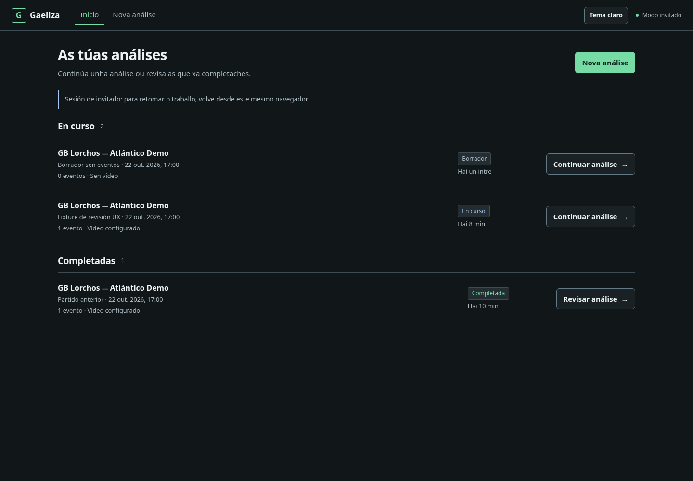
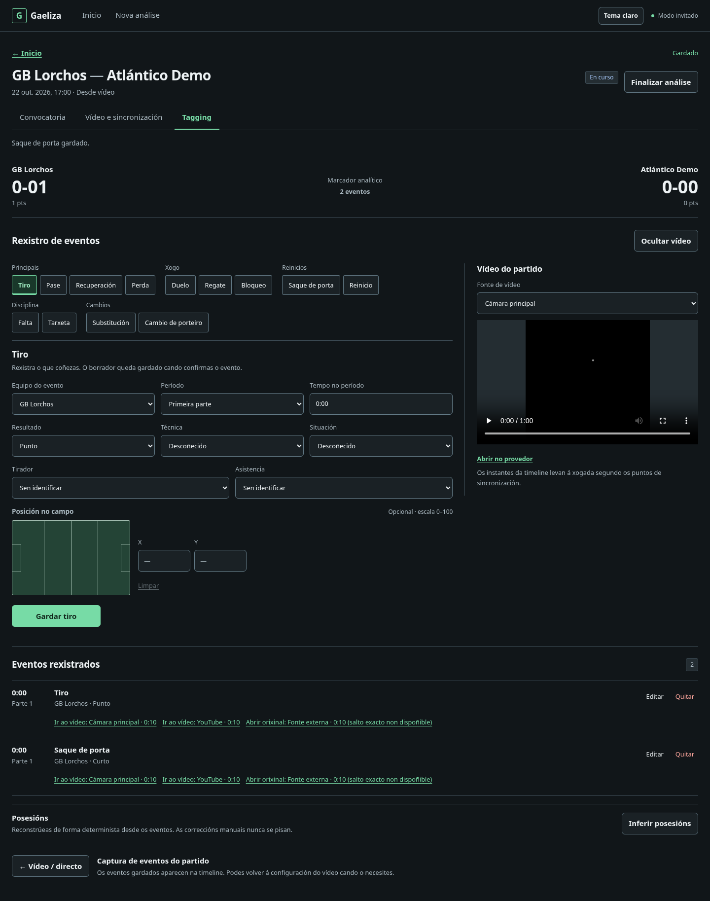
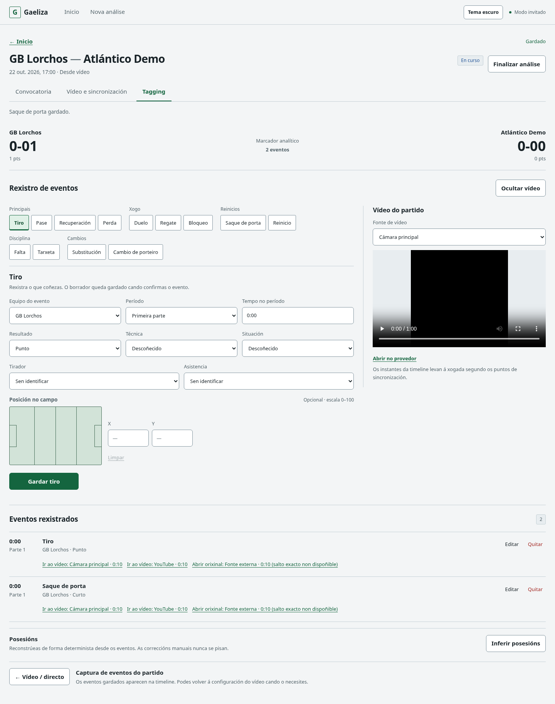
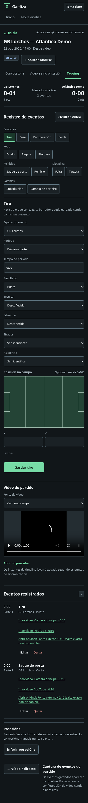
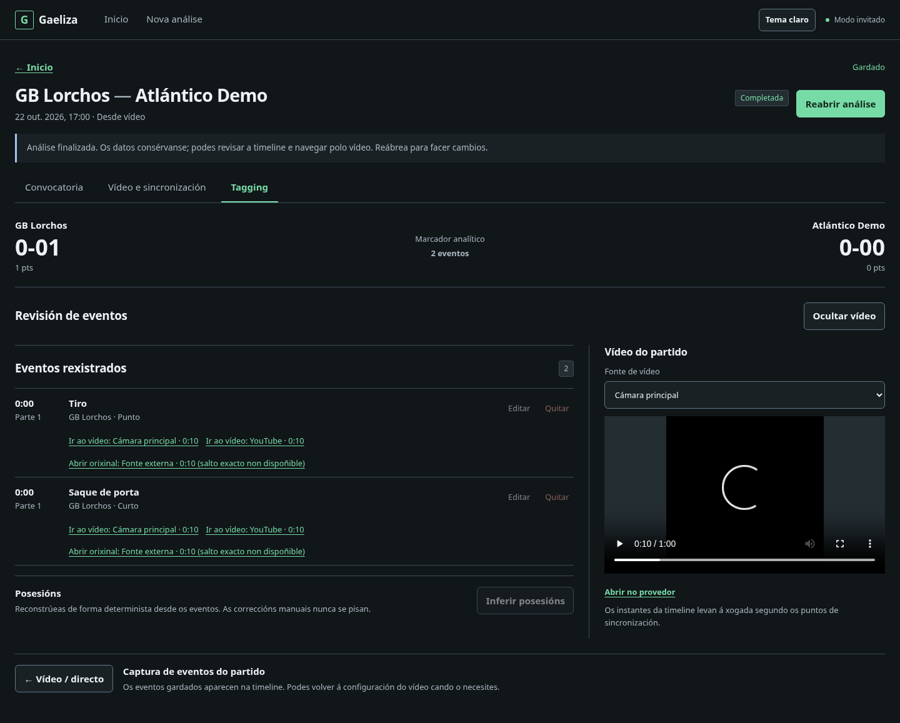
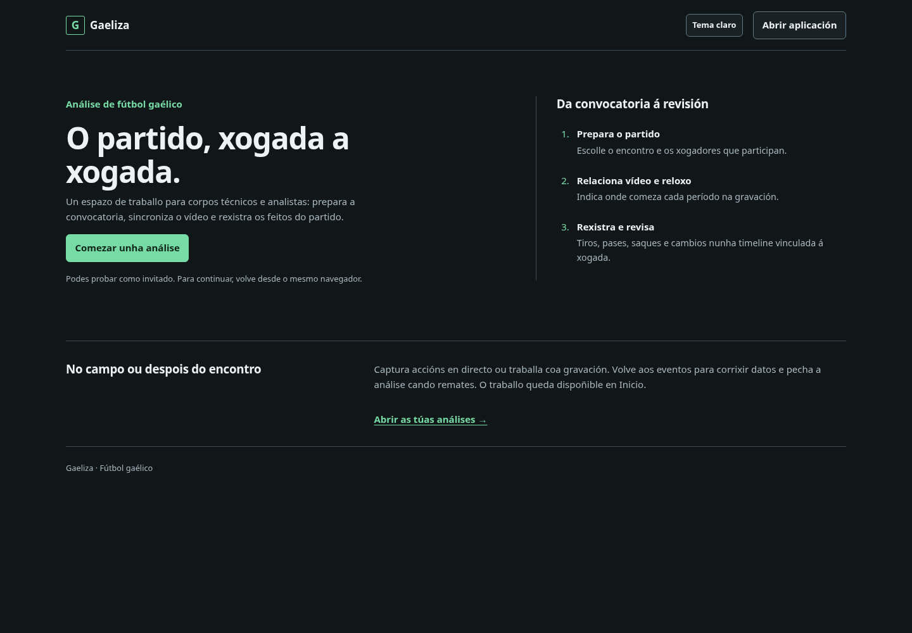

# Capturas de revisión UX v2

Capturas actualizadas tras la revisión de actividad del agregado y copy gallego,
generadas con el browser smoke local.
Los equipos, análisis y eventos son fixtures identificadas de prueba; el vídeo
es un WebM negro local. No son datos de usuarios ni actividad de producción.

## Dashboard oscuro

## Tagging de escritorio — oscuro

## Tagging de escritorio — claro

## Tagging móvil

## Análisis completado

## Landing

Las imágenes están en documentación y no se importan en la aplicación.
Ver [informe de revisión](../../v2-ux-design-review.md) y
[sistema de diseño](../../DESIGN.md).
