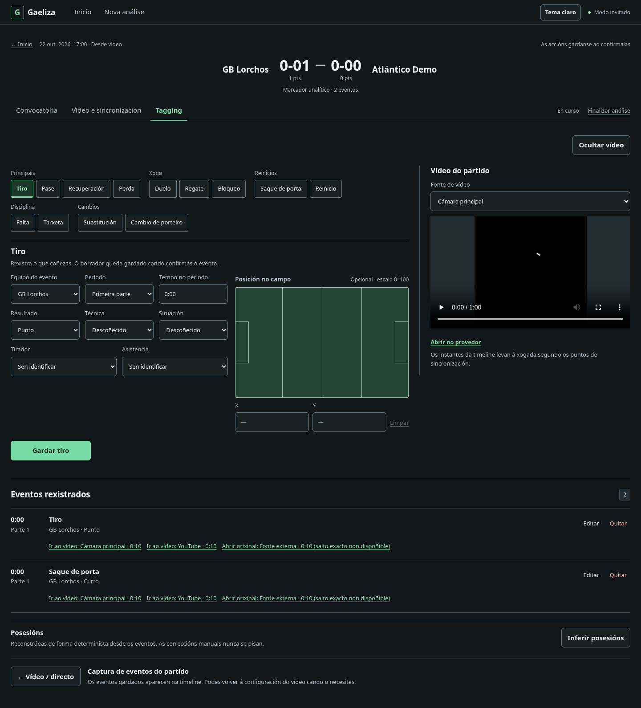
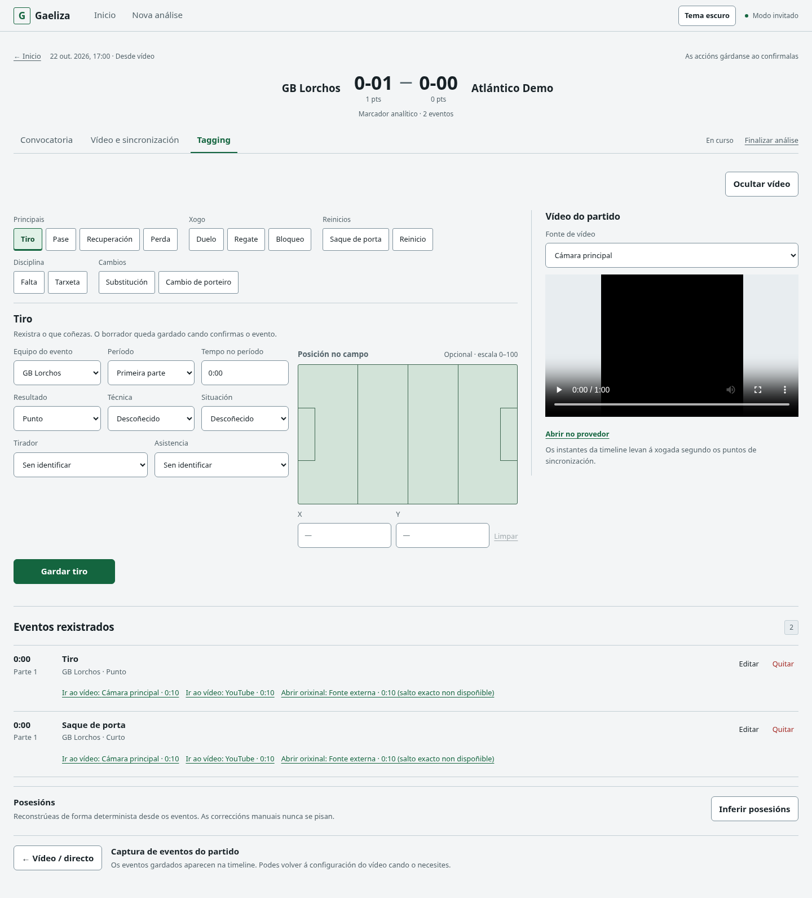
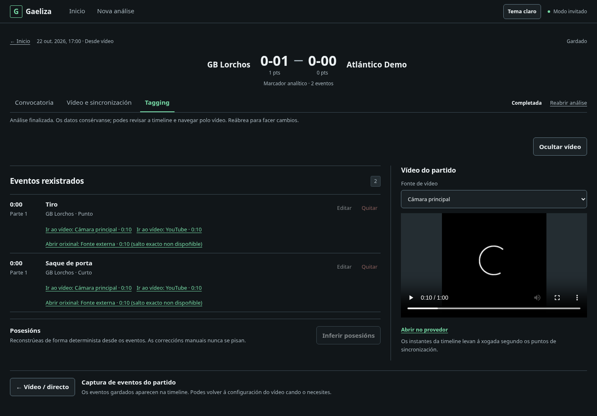
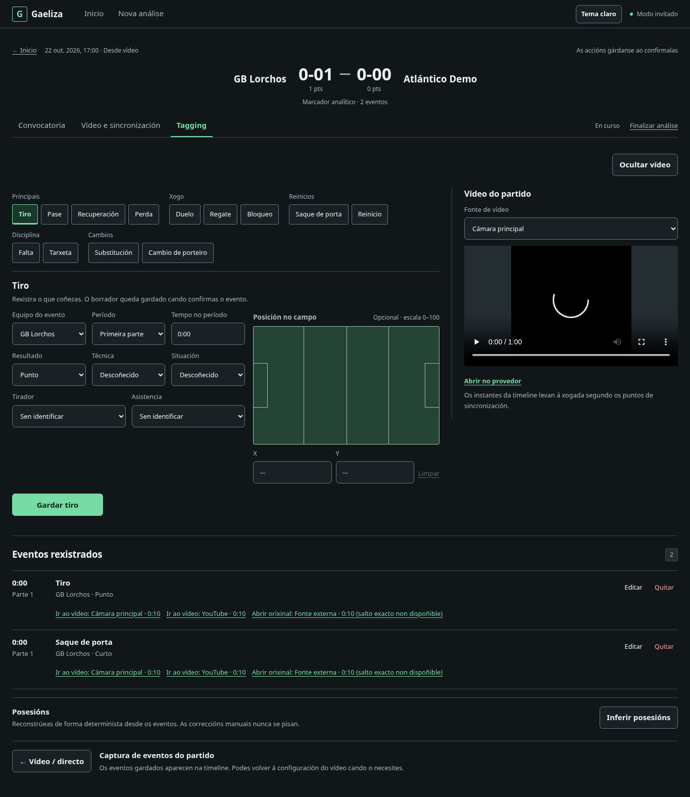
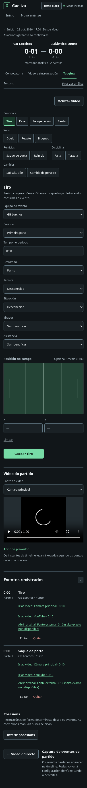
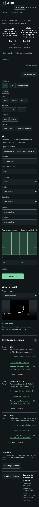

# Workspace shell y jerarquía — PR A

Capturas locales con fixtures sintéticos, sin Supabase remoto. No se modifican las capturas anteriores. Los PNG son full-page; los viewports usados se indican debajo. El vídeo negro es una fixture local, no contenido de producción.

En Tagging se reúnen nombre de equipos y score en un único H1, manteniendo el cálculo gaélico existente, totales secundarios y la etiqueta «Marcador analítico». Convocatoria/vídeo usan título compacto sin marcador. El encabezado semántico de registro/revisión permanece disponible para lectores de pantalla con presentación visual discreta.

## Escritorio 1440×900

[Convocatoria](roster-desktop-dark.png) · [Vídeo](video-desktop-dark.png) · [Tagging dark](tagging-desktop-dark.png) · [Tagging light](tagging-desktop-light.png) · [Completed](completed-desktop-dark.png) · [Nombres largos](long-names-desktop-dark.png)







## Escritorio 1366×768



## Móvil

[390×844](tagging-390-dark.png) · [320×568](tagging-320-dark.png) · [Nombres largos a 320](long-names-320-dark.png)





## Estados de recuperación

[Error de mutación](mutation-error-desktop-dark.png) · [Commit confirmado, recarga pendiente](requires-reload-desktop-dark.png) · [Error inicial](load-error-desktop-dark.png) · [Loading inicial](loading-desktop-dark.png)

Errores y completed pueden ampliar la altura natural. El commit confirmado conserva Gardado y explica que no se debe repetir la operación; no se presenta como escritura fallida.

## Medidas observadas y comparación

[Medidas del navegador](measurements.json), en píxeles CSS y texto normal:

| Viewport/estado | Shell global | Contexto + navegación |
| --- | ---: | ---: |
| 1440×900, Tagging | 56 | 191,7 |
| 1440×900, Convocatoria / Vídeo | 56 | 138,7 |
| 1366×768, Tagging | 56 | 191,7 |
| 768×1024, Tagging | 96,5 | 258,9 |
| 390×844, Tagging | 96,5 | 280,8 |
| 320×568, Tagging | 130,5 | 332,8 |
| 1440×900, nombres largos | 56 | 191,7 |
| 320×568, nombres largos | 130,5 | 404,8 |

La medida de contexto incluye fecha/modo, volver, zona reservada de guardado, equipos/score, caption y navegación/lifecycle; excluye shell global y padding de página. No hay height fija. Dark/light conservan exactamente la altura del contexto en escritorio. En móvil hay más filas de navegación y nombres; no se comprime el texto para perseguir la altura desktop. Sin overflow a 768/390/320, incluidos nombres largos; también se comprobó texto al 200% a 320 px.

Comparación visual contra [Tagging previo con shell completo](../v2-ux-design-foundation/tagging-desktop-dark.png), [ergonomía previa](../v2-tagging-ergonomics/desktop-video.png) y [Convocatoria previa](../v2-roster-ergonomics/desktop-both-teams.png): se elimina el título visual duplicado del partido en Tagging, las cifras dejan de estar en extremos opuestos y lifecycle se integra en la fila de navegación; desaparece la franja visual de «Rexistro de eventos». Las fixtures históricas no son idénticas ni todas incluyen el shell de producto; no se afirma una reducción numérica contra ellas. Campos, pitch, trece botones, timeline y vídeo mantienen su composición anterior a este slice.

## Regeneración

Desde `gaeliza-frontend`, con Playwright/Chromium disponibles externamente:

```sh
SHELL_SCREENSHOT_DIR=../docs/screenshots/v2-workspace-shell-hierarchy node --test tests/ux-browser.mjs
```

El harness acepta `PLAYWRIGHT_CHROMIUM_EXECUTABLE_PATH`. Los nuevos casos verifican URL/etapa, una sola cabecera de partido, score (punto/gol), lifecycle/readonly/reapertura, nombres largos, overflow, guardado estable, error de mutación, fallo de recarga tras commit y carga/error inicial. No se cambian los contratos de persistencia.

No se implementa PR B: siguen pendientes la reorganización profunda de captura, pitch/form, botones, selector móvil de acción y timeline compacta.

Validación final local: npm ci/audit/lint/build correctos; audit con cero vulnerabilidades, 143 pruebas Node y 76 resultados de browser verdes (70 escenarios más 6 contenedores). Permanece el warning conocido del bundle >500 kB (~626 kB). PostgreSQL fresh no ejecutado: este slice no modifica DB y el encargo lo excluye.
